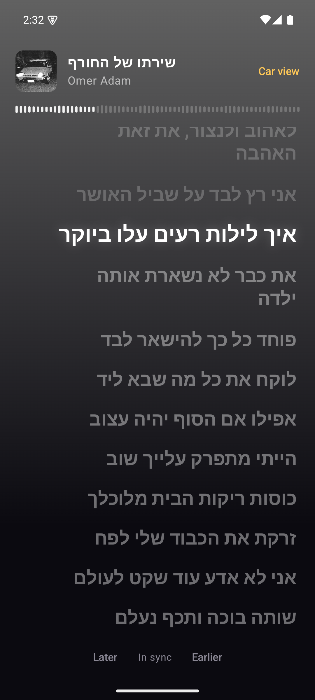
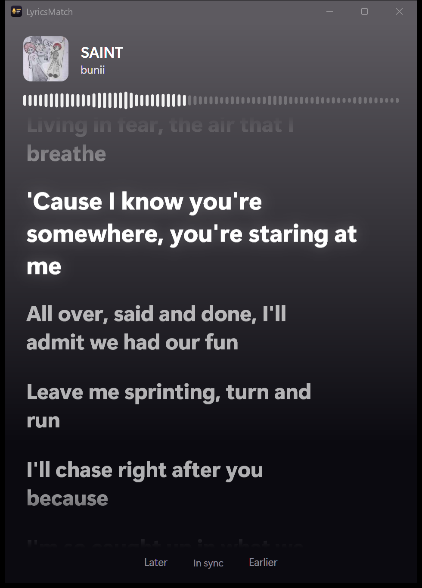

<div align="center">


# LyricsMatch

Live, line-by-line lyrics for whatever you're playing. Android (with Android Auto) and Windows.

</div>

<p align="center">
  
  &nbsp;
  
  &nbsp;
  
</p>

## Why I made this

I wanted to do karaoke in the car. Spotify has synced lyrics, but they're buried in the app and not really made to be read from a phone mount. So I built a small app that listens for whatever song is playing, finds the timed lyrics and highlights each line as it's sung, with a big-text mode for the car.

It works with Spotify, YouTube Music, Apple Music, Deezer, Tidal and basically any app that shows up in your media controls.

## What it does

- Picks up the current song automatically. No searching, no login.
- Highlights the line being sung and scrolls along with the song. Tap a line to jump there.
- Switches to a big, high-contrast **Car view** on its own when the phone connects to Android Auto.
- Can also show the lyrics on the car's own display (optional, see below).
- Shows the album art and tints the background to match it. If the player doesn't give a cover, it looks one up online.
- The progress bar is a row of equalizer bars that move with the music. Tap it to seek.
- Hebrew (and other right-to-left) songs are laid out right to left.
- If a song only has plain lyrics, it shows the full text and scrolls it with the song. If there are no lyrics at all, you get the album art, the song info and the bars.
- **Later / Earlier** buttons if the timing is a bit off.
- Remembers lyrics it already found, so replays load instantly even with bad signal.

No accounts, no ads, and it never draws on top of other apps.

## Installing on Android

1. Grab `LyricsMatch.apk` from the [Releases](../../releases) page on your phone and open it. Android will ask you to allow installing from your browser or file manager.
2. Open LyricsMatch, tap **Allow access**, and switch LyricsMatch on in the screen that opens.

That's it, play something.

If the switch in step 2 is greyed out, that's Android blocking the setting for apps that aren't from the Play Store. Go to **Settings > Apps > LyricsMatch > ⋮ (top right) > Allow restricted settings** and try again.

**About the equalizer bar on Android:** the app will offer to make the bar react to the music. That needs audio access, which is why Android shows a "record audio" prompt. The sound is only analyzed on the phone and never recorded or sent anywhere. If you skip it (or your phone doesn't share audio from that app), the bars just do a beat-style animation instead.

## Using it in the car

Everything runs on the phone. Nothing gets installed on the car.

**Lyrics on the phone (easiest):** put the phone in a mount, connect to Android Auto like you normally do, and open LyricsMatch. It switches to Car view by itself and keeps the screen on while music is playing. You can try Car view at home with the button at the top.

**Lyrics on the car's screen:** Android Auto only shows apps it trusts, and this one isn't from the Play Store, so you have to allow it once:

1. On the phone, go to **Settings > Connected devices > Connection preferences > Android Auto**.
2. Scroll down and tap **Version** about 10 times until it offers developer settings, and accept.
3. In the **⋮ menu > Developer settings**, turn on **Unknown sources**.
4. Reconnect to the car. LyricsMatch shows up in the Android Auto launcher.

On the car screen it uses Android Auto's own templates, so the car decides how much text to show while you're driving.

Please don't actually read lyrics while driving. Car view is meant for passengers and quick glances.

## Windows

<p align="center">
  
</p>

Download `LyricsMatch-Windows.exe` from [Releases](../../releases) and run it. There's no installer. Windows might say "Windows protected your PC" because the exe isn't signed; click **More info > Run anyway**.

Then play something in Spotify (desktop or web) or any other player and the lyrics follow along. The equalizer bar reacts to whatever your PC is playing (analyzed locally, nothing is recorded).

- **F11**: full screen, good for a TV or a second monitor
- **Left / Right arrows**: lyrics later / earlier
- **Click a line or the bar**: jump to that point in the song (if your player supports it)

The text scales with the window. Needs Windows 10 (2004) or Windows 11.

## If something's off

- **Lyrics are ahead of the singer:** tap **Later** (each tap is 0.25 s). Behind? Tap **Earlier**.
- **"No lyrics for this song":** the song just isn't in the lyrics database yet. The next song loads by itself, and if you were offline it retries on its own.
- **Only plain text, no highlighting:** that song has lyrics but no timing yet.
- **Nothing happens when music plays (Android):** check that notification access is still on.

## Privacy

- Android only lets an app see what's playing if it has notification access, which is why the app asks for it. It never reads your notifications.
- To find lyrics, the song's title, artist, album and length are sent to [LRCLIB](https://lrclib.net), and to [lyrics.ovh](https://lyrics.ovh) if LRCLIB doesn't have it.
- If your player doesn't provide album art, the artist and title are sent to the [iTunes](https://www.apple.com/itunes/) search API to find the cover.
- Audio for the equalizer is analyzed on the device and never recorded, saved or sent.
- No accounts, no analytics.

## Credits

Synced lyrics come from [LRCLIB](https://lrclib.net), a free, community-run lyrics database. If a song is missing or out of sync, you can add or fix it there. Plain-text fallback lyrics come from [lyrics.ovh](https://lyrics.ovh).

## Building it yourself

**Android:** you need JDK 17 and the Android SDK (platform 35); Android Studio comes with both.

```bash
./gradlew assembleDebug        # app/build/outputs/apk/debug/app-debug.apk
./gradlew testDebugUnitTest    # unit tests
```

**Windows:** C# / WPF on .NET 10, in [`windows/`](windows).

```bash
cd windows/LyricsMatch.Windows
dotnet run
dotnet publish -c Release -r win-x64 --self-contained -p:PublishSingleFile=true -o ../publish
```

<details>
<summary>How it's put together</summary>

On Android, a notification listener service watches the active media session (that's how it sees any music app). Lyrics come from LRCLIB and get cached, the LRC parser works out the current line, and one shared state feeds both the phone UI (Jetpack Compose) and the optional Android Auto screen (Car App Library templates). Car view turns on through `CarConnection` when the phone is projecting.

| What | Where |
| --- | --- |
| Watching the current song | `app/.../media/MediaListenerService.kt` |
| Finding and caching lyrics | `app/.../lyrics/LyricsRepository.kt` |
| Parsing LRC / current line | `app/.../lyrics/LrcParser.kt` |
| Shared state (song, lyrics, line) | `app/.../lyrics/Karaoke.kt` |
| Phone UI and Car view | `app/.../ui/App.kt` |
| Android Auto screen | `app/.../car/LyricsScreen.kt` |

The Android Auto screen keeps the template's title and row count the same between updates, so each line change counts as a refresh and stays inside Android Auto's template limits.

On Windows, the app reads the song from the system media sessions (the same thing the volume flyout uses) and does the same LRCLIB lookup and LRC parsing.

To test on Android without a music app, debug builds include a fake player:

```bash
adb shell cmd notification allow_listener com.lyricsmatch/com.lyricsmatch.media.MediaListenerService
adb shell am broadcast -n com.lyricsmatch/.DemoPlayerReceiver --es title "Africa" --es artist "Toto" --el startMs 60000
```

</details>
