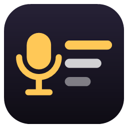

<div align="center">



# LyricsMatch

**Live, line-by-line lyrics for whatever you're playing, built for singing in the car.**

For **Android** (with Android Auto) and **Windows**. Works with Spotify, YouTube Music, Apple Music, Deezer, Tidal and other music apps.

</div>

<p align="center">
  
  &nbsp;
  
  &nbsp;
  
</p>

---

## ✨ What it does

- 🎵 **Detects the current song automatically.** Press play in your music app and the lyrics show up. You don't need to search or log in.
- 🎨 **Matches the music:** shows the album art (if your player has none, it finds the cover online) and tints the background to the cover's color.
- 🇮🇱 **Hebrew and Arabic support:** right-to-left songs are laid out right-to-left automatically.
- 📊 **Equalizer progress bar:** the song's progress bar is a row of bars that move with the music. Tap anywhere on it to jump to that point.
- 📜 **Plain lyrics as a fallback:** for songs without timed lyrics, the full text scrolls along with the song.
- 🎶 **No lyrics? Still something to watch:** the album art, the song info and a live spectrum of the music.
- ⏱️ **Highlights each line as it's sung**, karaoke style, and scrolls along with the music.
- 🚗 **Switches to Car view by itself** when your phone connects to Android Auto: big, high-contrast text with only the current line and the next two.
- 📺 **Can also show lyrics on the car's display** (optional, see below).
- 👆 **Tap any line** to jump the song to that spot.
- 🎚️ **Fix the timing with one tap** if the lyrics are a little early or late.
- 💾 **Saves lyrics you've already played**, so replays load instantly, even with a weak signal.
- 🧘 **Keeps things simple:** no accounts, no ads, no pop-ups on top of other apps.

## 📲 Install on Android

1. Download the latest `LyricsMatch.apk` from the [**Releases**](../../releases) page on your phone.
2. Open it and allow installing from your browser or file manager when Android asks.
3. Open **LyricsMatch** and tap **Allow access**. On the next screen, switch LyricsMatch **on**.

> **Is the switch greyed out?** Android blocks this setting for apps installed outside the Play Store until you unlock it:
> **Settings › Apps › LyricsMatch › ⋮ (top right) › Allow restricted settings**, then try again.

That's it. Play a song and sing along. 🎤

> **Optional: equalizer that follows the music.** LyricsMatch may offer *"Make the bar react to the music?"*. If you tap **Allow**, Android asks for audio access so the bars can follow the real sound. Sound is analyzed on your phone only and is never recorded or sent anywhere. If you skip it, the bars use a beat-style animation instead. Some phones don't share audio from certain apps; the beat-style animation is used then too.

## 🚗 Using it in the car

LyricsMatch runs on your **phone**. You don't install anything on the car's screen or head unit.

### Option A: lyrics on your phone (simplest)

1. Put your phone in a holder that's easy to see.
2. Connect to Android Auto as usual and open LyricsMatch on the phone.
3. It switches to **Car view** automatically, with large text and the screen kept on while music plays.

You can try Car view at home too: tap **Car view** at the top of the screen.

### Option B: lyrics on the car's display

The car display only shows apps that Android Auto trusts. Because LyricsMatch isn't from the Play Store, you need to allow it once:

1. On your phone, open **Settings › Connected devices › Connection preferences › Android Auto**.
2. Scroll to the bottom and tap **Version** about 10 times until you're asked to enable developer settings. Accept.
3. Open the **⋮ menu › Developer settings** and turn on **Unknown sources**.
4. Reconnect to your car. **LyricsMatch** now shows up in the Android Auto app launcher.

On the car display, lyrics use Android Auto's own templates. The car decides how much text it shows while you're moving, which keeps it within the driving safety rules.

## 💻 On Windows

1. Download `LyricsMatch-Windows.exe` from the [**Releases**](../../releases) page. There's no installer, so you can put it anywhere and double-click it.
2. Windows may show *"Windows protected your PC"* because the app isn't signed. Click **More info › Run anyway**.
3. Play something in Spotify (desktop app or web player) or any other music app. The lyrics follow along automatically.

| Shortcut | What it does |
| --- | --- |
| **F11** | Full screen: big lyrics for karaoke on a TV or second screen |
| **← / →** | Make lyrics later / earlier |
| **Click a line** or **the equalizer bar** | Jump to that part of the song (if your music app allows it) |

The text gets bigger as you make the window bigger. The equalizer bar follows whatever your PC is playing; the audio is only analyzed on your PC and never recorded. Requires Windows 10 (version 2004) or Windows 11.

## 🎚️ Tips

| If… | Do this |
| --- | --- |
| Lyrics are **ahead** of the singer | Tap **Later** at the bottom (each tap is 0.25 s) |
| Lyrics are **behind** the singer | Tap **Earlier** |
| It says *"No lyrics for this song yet"* | That song isn't in the lyrics library yet. Just keep listening: the next song loads by itself. If you were offline, it retries automatically |
| Only the full text shows, with no highlighting | That song has no timed lyrics yet, so the plain text is shown instead |
| Nothing happens when music plays (Android) | Check that notification access is still on (step 3 of Install) |

## 🔒 Privacy

- On Android, LyricsMatch asks for **notification access** only because Android requires it before an app can see which song is playing. It **never reads your notifications**.
- The only data sent anywhere is the **song title, artist, album and length**, sent to [LRCLIB](https://lrclib.net) (and to [lyrics.ovh](https://lyrics.ovh) if LRCLIB has nothing) to look up lyrics.
- Album art comes from your music app. Only when it has none is the cover looked up on [iTunes](https://www.apple.com/itunes/) (artist and title only).
- The equalizer analyzes sound on your device only (on Android, only if you opt in). Audio is never recorded, saved or sent.
- There are no accounts, analytics or ads.

## 🙏 Credits

Synced lyrics come from **[LRCLIB](https://lrclib.net)**, a free, community-built lyrics library. If a song is missing or out of sync, you can contribute it there. When LRCLIB doesn't have a song, plain lyrics come from **[lyrics.ovh](https://lyrics.ovh)**.

## ⚠️ Drive safely

Keep your eyes on the road. LyricsMatch is meant for **passengers and quick glances**. Car view and the Android Auto display are kept minimal for that reason.

---

<details>
<summary><b>🛠️ For developers</b></summary>

### Build (Android)

Requirements: JDK 17 and the Android SDK (platform 35). Android Studio includes both.

```bash
./gradlew assembleDebug        # app/build/outputs/apk/debug/app-debug.apk
./gradlew testDebugUnitTest    # unit tests
```

### How it works

| Piece | File |
| --- | --- |
| Watches the active media session (any music app) | `media/MediaListenerService.kt` |
| Finds and caches synced lyrics from LRCLIB | `lyrics/LyricsRepository.kt` |
| Parses LRC and finds the current line | `lyrics/LrcParser.kt` |
| Shared state for phone and car (song, lyrics, current line) | `lyrics/Karaoke.kt` |
| Phone UI and automatic Car view (Jetpack Compose) | `ui/App.kt` |
| Optional Android Auto display (Car App Library templates) | `car/LyricsScreen.kt` |

Car view turns on automatically through `CarConnection` when the phone is projecting to Android Auto. The car-display screen keeps the template's title and row count fixed, so each line change counts as a *refresh* and stays within Android Auto's template limits.

### Windows app

C# / WPF on .NET 10, in [`windows/`](windows). It reads the song from Windows' system media sessions (the same source as the volume pop-up) and uses the same LRCLIB lookup and LRC parsing as the Android app.

```bash
cd windows/LyricsMatch.Windows
dotnet run                                   # run it
dotnet publish -c Release -r win-x64 --self-contained -p:PublishSingleFile=true -o ../publish
```

### Demo without a music app (Android debug builds)

```bash
adb shell cmd notification allow_listener com.lyricsmatch/com.lyricsmatch.media.MediaListenerService
adb shell am broadcast -n com.lyricsmatch/.DemoPlayerReceiver --es title "Africa" --es artist "Toto" --el startMs 60000
```

</details>
